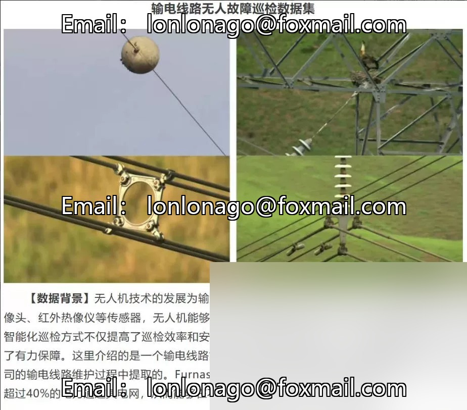
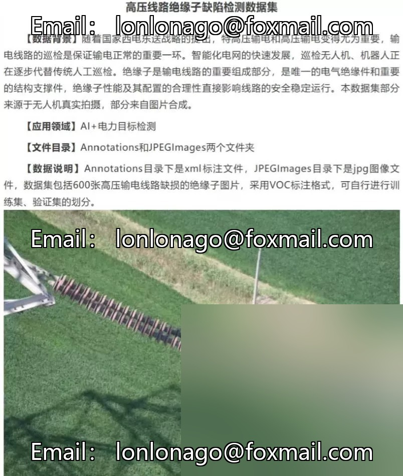
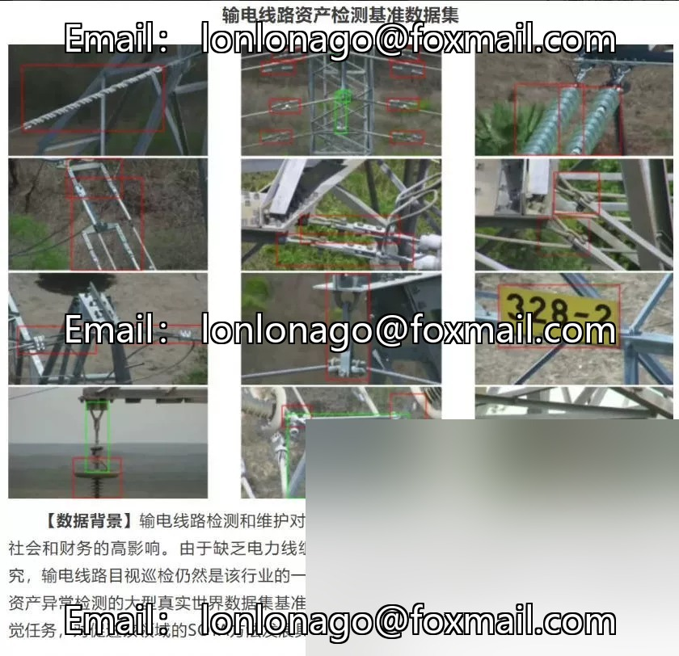
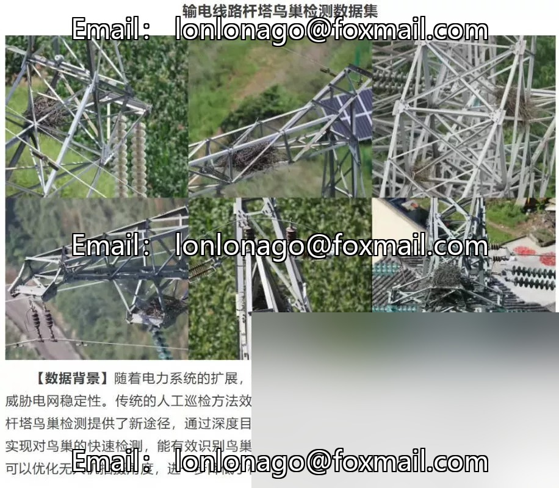
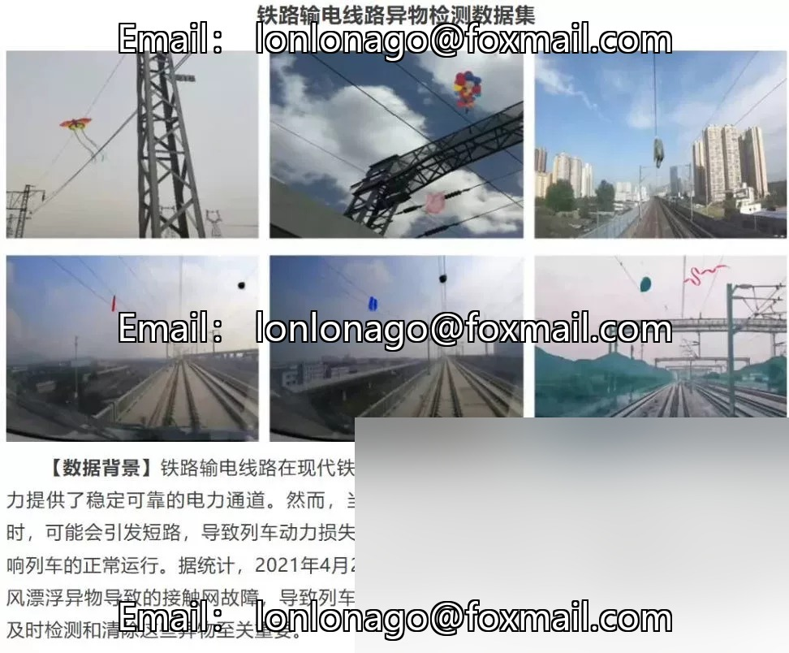
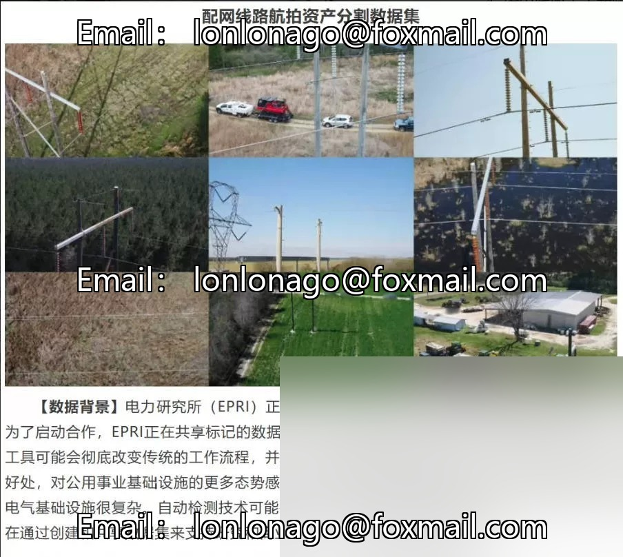

# Power transmission line dataset 13-set

## Body

Transmission line dataset (13 sets)
1. Transmission line unobstructed fault inspection dataset
2. Transmission line asset detection benchmark dataset
3. Transmission line tower bird nest detection dataset
4. Railway transmission line foreign object detection dataset
5. Distribution network line aerial asset segmentation dataset
6. Transmission line aerial instance segmentation dataset
7. Transmission line hardware dataset
8. High-voltage line insulator defect detection dataset
9. Transmission line insulator remote sensing detection dataset
10. Transmission tower remote sensing detection dataset
11. Substation intelligent inspection dataset
12. South China Grid tower foreign object detection dataset
13. Transmission line tower target detection dataset

List price is the price for a single dataset! Find to inquire about which set you want.

web-based shipment, can be directly photographed and shipped.

The dataset consists of 13 types, including unmanned fault inspection, asset detection, tower bird nests, foreign object detection, aerial division and other scenarios.

<!-- AI_ENRICHED -->

## Images

## Payment

Here is a pay link on Stripe ( https://buy.stripe.com/3cs8yP7sY87d0vu9AB ). Please contact me lonlonago@foxmail.com after funding $89, and I will send you a complete data files , thank you!

